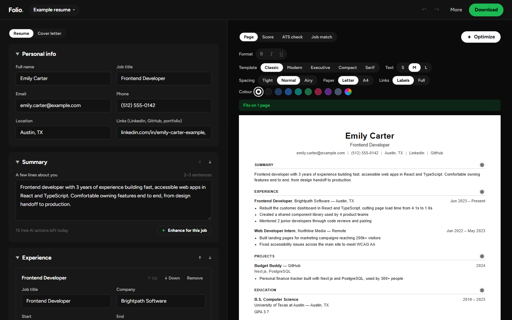

# Folio

**A free resume builder that doesn't charge you at the download button.**

Write your resume, see it on a real page as you type, check what applicant tracking software will read, and save a clean PDF. No sign-up, no watermark, no paywall.

**[Try it live →](https://resume-builder-chi-dusky.vercel.app)** · [See an example](https://resume-builder-chi-dusky.vercel.app/builder?example)



## Why Folio

Most resume builders let you spend half an hour writing, then ask for a subscription before you can download. Folio was built around the complaints people have about those tools:

| Common problem | What Folio does instead |
| --- | --- |
| Download locked behind a paywall | PDF download is free, with no watermark |
| Account required before you can start | No account. Open the editor and type |
| Your data stored on someone's server | Saved only in your own browser |
| Fancy layouts that ATS software can't read | Every template is single-column, real text, standard headings |
| No idea if your resume will pass screening | A built-in ATS check shows exactly what the software reads |

## Features

- **Live preview on a real page:** Letter or A4, with a marker where page two starts
- **Three templates:** Classic, Modern and Serif, all ATS-safe
- **Fit to one page:** adjust text size and spacing with one click
- **Any section order:** put Education first, or Experience, or anything else
- **Extra sections:** certifications, awards, volunteering, languages, or your own
- **ATS check:** readiness checklist plus the plain text that tracking systems extract
- **Enhance with AI (optional):** click ✨ on your summary or bullets to get clearer, more professional wording. It fixes grammar and phrasing but never adds facts or numbers, and you choose whether to use it. 10 free uses per day
- **Input checks:** gentle warnings for phone numbers, emails, links and dates that look wrong
- **Autosave, undo and backup files** to move your resume between devices

## How it works

Folio is a [Next.js](https://nextjs.org) app. Your resume lives in your browser's local storage, and the PDF is produced by the browser's own print engine, so the text stays selectable, links stay clickable and ATS software can read it.

The only server code is one route, `/api/enhance`, used when someone clicks ✨ Enhance. It sends just that piece of text to [Groq](https://groq.com) and returns suggested wording. Nothing else is stored or sent anywhere.

```
app/                  Pages: home (/) and editor (/builder)
components/builder/   The editor form, toolbar and dialogs
components/resume/    The resume page, page-break preview and ATS view
lib/resume.ts         The resume data model and loading of saved data
lib/validate.ts       Checks for phone, email, link and date fields
lib/ats.ts            Plain-text export and ATS readiness checks
lib/enhance.ts        AI enhance rules: prompt, response parsing, daily limit
app/api/enhance/      Server route that calls the AI
lib/pages.ts          Page count and page-break math
lib/storage.ts        Browser storage
```

## Run it locally

You need [Node.js](https://nodejs.org) 20.9 or newer.

```bash
npm install
npm run dev
```

Then open [http://localhost:3000](http://localhost:3000).

To try ✨ Enhance locally, get a free API key at [console.groq.com](https://console.groq.com) and add it to a `.env.local` file:

```
GROQ_API_KEY=your-key-here
```

Everything else works without it.

| Command | What it does |
| --- | --- |
| `npm run dev` | Start the development server |
| `npm test` | Run the unit tests |
| `npm run lint` | Check code style |
| `npm run typecheck` | Check TypeScript types |
| `npm run build` | Build for production |

Every push to GitHub runs lint, type checks, tests and a production build automatically.

## License

[MIT](LICENSE)
