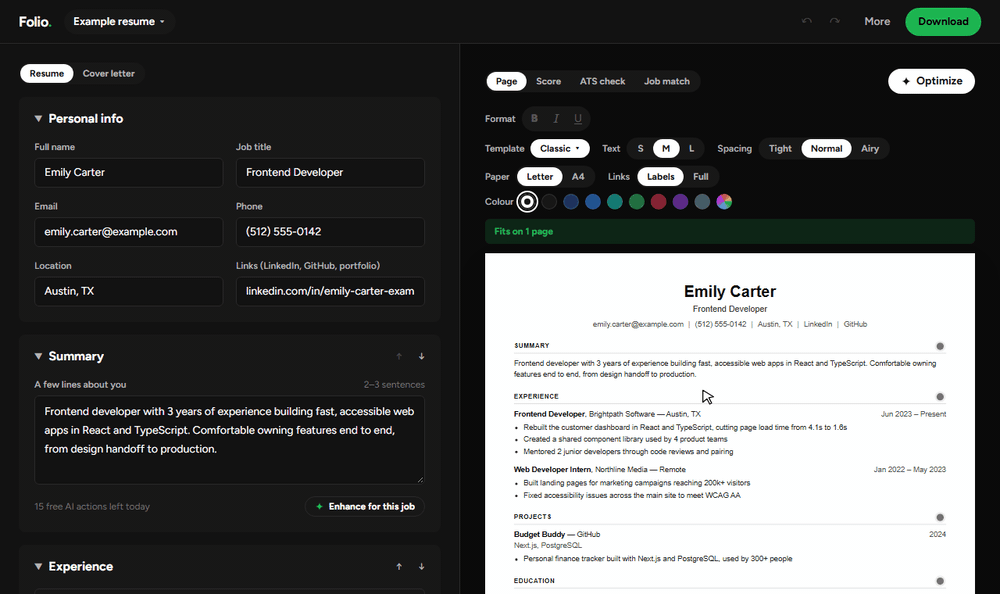
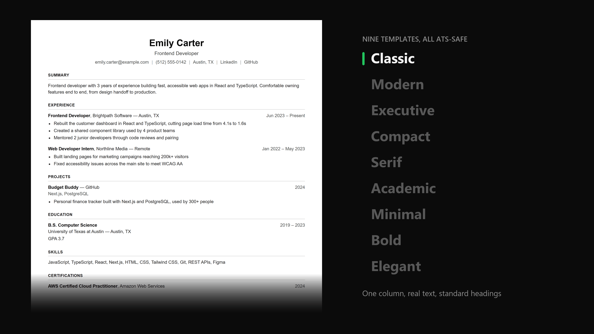
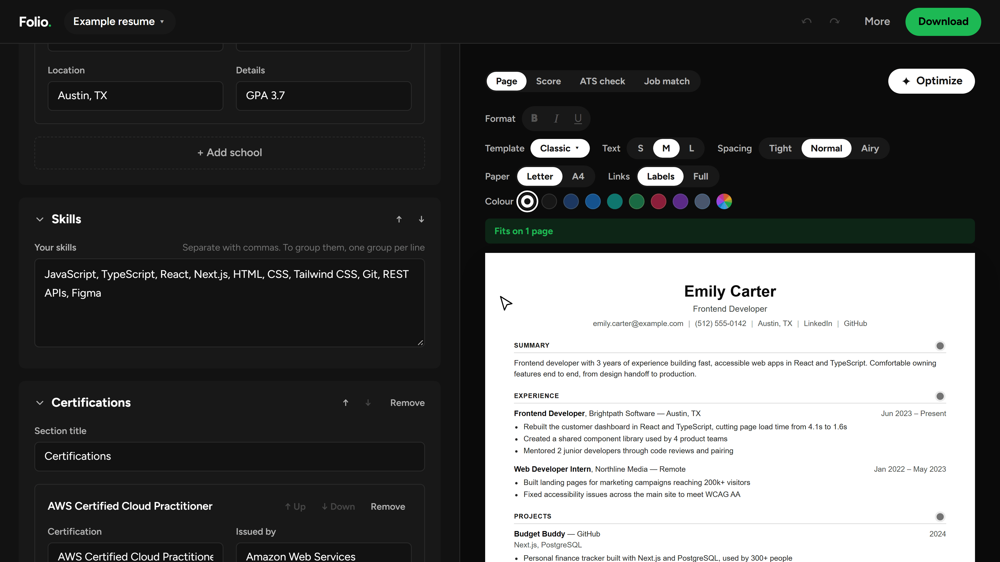

# Folio

**The resume builder that's actually free.**

No sign-up. No watermark. No "upgrade to download" after you've typed everything in.

**[Try it live →](https://folio-resumes.vercel.app)** · [See an example](https://folio-resumes.vercel.app/builder?example) · [Job match demo](https://folio-resumes.vercel.app/builder?example&view=job)



## You know how this goes

You find a "free" resume builder. You spend 40 minutes getting every bullet right. You hit **Download**.

*That'll be $24.99 a month.*

Folio just gives you the file.

| | Folio | Most resume builders |
| --- | --- | --- |
| Downloading your resume | Free PDF and Word, no watermark | Usually paid, or watermarked |
| Getting started | No account. Just start typing | Sign-up required |
| Job match and keywords | Free | Paid plans |
| AI writing help | Free daily, never invents facts | Paid, and known to inflate claims |
| Where your resume lives | In your own browser | On their servers |

## Nine templates. All of them get read.



Classic, Modern, Executive, Compact, Serif, Academic, Minimal, Bold and Elegant. Pick one from a gallery that previews **your** resume, not a stock one, then make the headings your colour.

Every template is ATS-safe: one column, real text and standard headings. An ATS (applicant tracking system) is the software most companies run your resume through before a human ever sees it. If it can't read your resume, nobody reads it.

## Write it like a doc

- **Edit right on the page.** Click any line and type. Bold, italic and underline work too. Enter splits a bullet, Backspace joins it back, and Alt+Up or Alt+Down moves it
- **Move whole sections** with the arrows next to each heading, or rename them ("Profile" instead of "Summary")
- **Know when it fits.** The preview shows a real Letter or A4 page and says "Fits on 1 page". The PDF comes out the same
- **Fit it on one page** with text size and spacing controls
- **Add any section:** certifications, awards, volunteering, languages, or your own
- **Clean links.** LinkedIn and GitHub show as short labels that still open the full address. Switch to full addresses for job portals that need them
- **Catches typos in your details:** warnings for phone numbers, emails, links and dates that look wrong
- **One resume per job type.** Duplicate, rename, undo, autosave
- **Backup file.** One file holds every resume, so you can keep them safe or open them on another device

## Get past the bots



- **Resume score:** out of 100, and every point is explained. No mystery number. Upload an old resume to score it in seconds
- **Job match:** paste a job posting and see your match score, the keywords you have, and the ones you're missing, live as you type. It understands short forms ("JS", "ML", "K8s")
- **ATS check:** 15 weighted checks covering contact details, education, dates, bullet formatting, skills, summary, action verbs, numbers and bullet length. Each one passes, warns or needs fixing, and tells you how to fix it. You can also see the exact plain text a tracking system pulls from your PDF

## AI that won't lie for you

15 free AI actions a day. The AI rewords what you wrote. It doesn't make up jobs, numbers or skills.

- **Build with AI:** talk or type about what you've done, in your own words. AI asks a few follow-up questions, then writes the resume from only what you said, and a fact-check pass runs afterwards
- **Import:** drop in an old PDF or Word resume, and every field fills in using your exact words
- **Optimize:** one click fixes the formatting, rewords weak lines and fits the layout to the fewest pages. Every change is highlighted on the page, with Revert for each one and Undo all. If a rewrite adds a number you didn't write, it gets thrown out
- **Enhance:** clearer wording for your summary and bullets, tuned to the job posting. Make it shorter, punchier, more formal or simpler, and go back to an earlier version anytime. It never turns "helped with" into "led"
- **Cover letters:** written only from your resume, then a second AI pass cuts anything your resume doesn't back up

## Download it. Actually.

- PDF with real, selectable text (tested: every template reads back cleanly)
- Word (.docx) for portals that ask for it
- Cover letter as PDF or Word

## Your data stays yours

No accounts, and your resumes never touch a server's storage. They live in your browser, and PDF and Word files are made on your device. AI only sees the text for the action you click, and that text is never stored. The only thing kept on a server is a daily count of AI requests per address, under a one-way hash, deleted after two days. More on the [privacy page](https://folio-resumes.vercel.app/privacy).

## Tech stack

| Area | Tools |
| --- | --- |
| App and UI | [Next.js](https://nextjs.org) 16, [React](https://react.dev) 19, [TypeScript](https://www.typescriptlang.org), [Tailwind CSS](https://tailwindcss.com) 4 |
| PDF and Word | [@react-pdf/renderer](https://react-pdf.org) for PDF, [docx](https://docx.js.org) for Word, [JSZip](https://stuk.github.io/jszip) for backup files |
| Reading uploads | [unpdf](https://github.com/unjs/unpdf) for PDF text, with Word files read as zipped XML |
| AI | [Groq](https://groq.com) open models; [Vercel AI Gateway](https://vercel.com/ai-gateway) when no Groq key is set |
| Rate limiting | [Vercel Firewall](https://vercel.com/docs/vercel-firewall) for bursts, plus a daily count per address in [Upstash Redis](https://upstash.com) shared by every server instance |
| Error monitoring | [Sentry](https://sentry.io) for crashes in the browser and server, and for AI failures people would notice. Errors only: no tracing, no session replays, no resume text |
| Testing | [Vitest](https://vitest.dev) for unit tests, [Playwright](https://playwright.dev) for browser tests |
| Quality and hosting | ESLint, GitHub Actions for checks, [Vercel](https://vercel.com) for hosting |

## How it works

Folio is a [Next.js](https://nextjs.org) app. The editor runs entirely in the browser. The only server code is a few small API routes that send the text for one AI action to [Groq](https://groq.com) (or Vercel AI Gateway) and return the result.

```
app/                        Pages: home, editor (/builder), privacy, and /api AI routes
components/builder/         The editor page: form, template picker, cover letter editor, import dialog, toolbar
components/builder/header/  The menus at the top: your resumes, More, and Download
components/builder/use*.ts  Hooks for the resumes, undo and autosave (useResumeLibrary) and Optimize (useOptimize)
components/resume/          Resume page (editable like Word), page-break preview, ATS check, job match, Optimize
components/resume/page/     The parts of the resume page: sections, bullets, contact line, each kind of entry
lib/resume.ts               The resume data model and safe loading of saved data
lib/rich.ts                 Bold, italic and underline in resume text, and the plain words for everything else
lib/templates.ts            How each template looks and its heading colour, shared by preview, PDF and Word
lib/optimize.ts             Optimize: the AI prompt, the fact check on its answer, layout fitting and the change list
lib/export/                 PDF (react-pdf) and Word (docx) generation
lib/jobmatch.ts             Job keyword extraction prompt and live matching
lib/enhance.ts              AI enhance rules, response cleanup, daily limit
lib/importer.ts             Resume import prompt and parsing
lib/coverletter.ts          Cover letter and fact-check prompts
lib/ats.ts                  Plain-text export, the ATS check and score, and "Fix automatically"
lib/library.ts              Multiple resumes
lib/backup.ts               Backup files with every resume
lib/storage.ts              Browser storage
lib/server/ai.ts            The AI provider call shared by every route, with retries when it's busy, and the daily limit per address
e2e/                        Browser tests (Playwright) that click through the built app
```

## Run it locally

You need [Node.js](https://nodejs.org) 20.9 or newer.

```bash
npm install
npm run dev
```

Then open [http://localhost:3000](http://localhost:3000).

AI features need a free API key from [console.groq.com](https://console.groq.com) in a `.env.local` file. Everything else works without it.

```
GROQ_API_KEY=your-key-here
```

| Command | What it does |
| --- | --- |
| `npm run dev` | Start the development server |
| `npm test` | Run the unit tests (including real PDF and Word generation) |
| `npm run lint` | Check code style |
| `npm run typecheck` | Check TypeScript types |
| `npm run build` | Build for production |
| `npm run e2e` | Build, then run the browser tests: a real Chrome clicks through the app (templates, backups, downloads, ATS check, import). Run `npx playwright install chromium` once first |

Locally, the daily AI limit per address is counted in memory. On Vercel it's counted in Upstash Redis, so it holds across server instances and restarts: connecting Upstash for Redis to the project adds `KV_REST_API_URL` and `KV_REST_API_TOKEN`. If Redis doesn't answer, the count falls back to memory rather than blocking anyone.

Error reporting is off unless `NEXT_PUBLIC_SENTRY_DSN` is set. On Vercel, also set `SENTRY_AUTH_TOKEN`, `SENTRY_ORG` and `SENTRY_PROJECT` so builds upload source maps, and reports show the real code instead of minified lines. Browser reports go through the `/sentry-tunnel` route on Folio's own address.

When Groq is busy, AI features retry: first on a smaller model (`AI_FALLBACK_MODEL`, default `openai/gpt-oss-20b`), which Groq limits separately, then on the main model after a short wait.

Every push to GitHub runs lint, type checks, unit tests, a production build and the browser tests. Only when all of them pass on `main` does GitHub Actions trigger the Vercel production deploy, through a deploy hook (the `VERCEL_DEPLOY_HOOK` repository secret). Vercel's own deploy on push is turned off in `vercel.json`, so a broken change never goes live.

## Feedback

Found a bug or have an idea? Use **Send feedback** in the app, or [open an issue](https://github.com/AryanLanke/folio/issues/new).

## License

[MIT](LICENSE)
